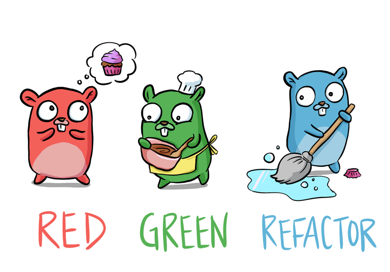

# Go With Tests

<p align="center">
  
</p>

Practice projects for learning test-driven Go, based on
[Learn Go with Tests](https://github.com/quii/learn-go-with-tests).

This repository is organized as a Go workspace. Each chapter-style directory is
its own small module, which keeps the examples isolated while still letting the
whole repo be tested from one place.

## What This Shows

- Table-driven tests for functions, methods, and interfaces
- Examples and benchmarks with Go's standard `testing` package
- Dependency injection with `io.Writer` and test doubles
- Error handling and custom errors
- Concurrency tests for goroutines, channels, and synchronization
- HTTP behavior tested with `net/http/httptest`
- Reflection-based tests
- Property-based tests with `testing/quick`
- Fuzz tests with Go's native fuzzing support

## Project Layout

| Directory | Focus |
| --- | --- |
| `arrays_and_slices` | Table-driven tests for slice operations |
| `blogposts` | Reading markdown posts from `fs.FS` |
| `blogrenderer` | Rendering blog posts to HTML |
| `concurrency` | Concurrent website checks |
| `dependency_injection` | Injecting writers and collaborators |
| `hamming` | String comparison and validation |
| `interfaces` | Interfaces, structs, and methods |
| `maps_baby` | Map-backed dictionary behavior |
| `mocking` | Test doubles for time-dependent code |
| `moreConcurrency` | Sequential vs concurrent frequency counting |
| `property_based_tests` | Roman numeral conversion, properties, and fuzzing |
| `reflection` | Walking arbitrary values with reflection |
| `select` | Racing HTTP requests with timeouts |
| `sync` | Mutex-protected counters |

## Requirements

- Go 1.26 or newer
- `make` for the repo-level test shortcut

## Run The Tests

Run every module:

```sh
make test
```

Run the same checks as CI:

```sh
make ci
```

Run one module:

```sh
cd property_based_tests
go test ./...
```

Run benchmarks:

```sh
cd iteration
go test -bench=.
```

Run fuzzing for the Roman numeral converter:

```sh
cd property_based_tests
go test -fuzz=FuzzRomanNumeralRoundTrip
```

## Notes

Most examples intentionally use the Go standard library only. That keeps the
focus on Go idioms: small packages, explicit tests, simple interfaces, and fast
feedback from `go test`.

Original gopher art by [Denise Yu](https://twitter.com/deniseyu21).
